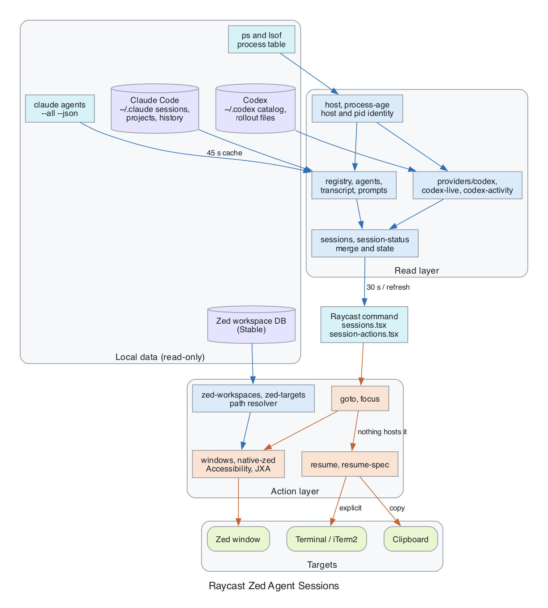
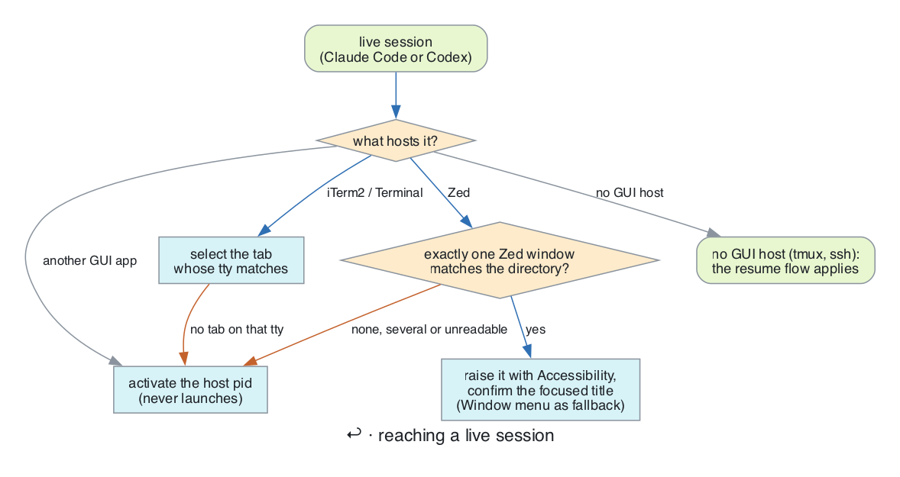
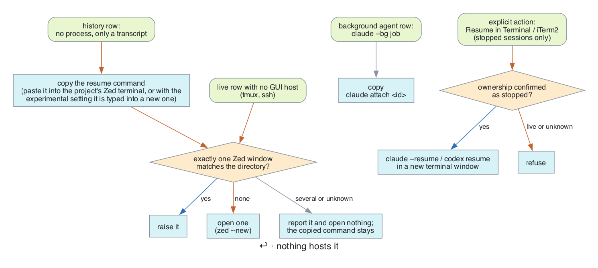

# Raycast Zed Agent Sessions

Search local **Claude Code and Codex** sessions from Raycast and jump back to their project windows in Zed.

Extends the original Claude Code Sessions extension. The extension name (`claude-code-sessions`) and command ID (`sessions`) are unchanged, so existing aliases and shortcuts keep working.

## Usage

1. Install: `npm install && npm run dev` loads the extension into Raycast.
2. Grant Raycast macOS Accessibility permission (System Settings > Privacy & Security > Accessibility). Window selection needs it.
3. Open the **Coding Agent Sessions** command. Type to search; pick Claude or Codex in the top dropdown.
4. Press **Enter** on a row:
   - **Open Session** (live process): jumps to its Zed window or terminal tab.
   - **History** (stopped): copies the resume command and moves to the project's Zed window, or opens one if none exists. Paste the command into that project's Zed terminal.
5. Press **Cmd+K** for more actions: transcript, filters, Choose Zed Window, resume in Terminal/iTerm2. Shortcuts are listed under [Actions](#actions).

## Features

- One searchable list for both providers, with provider labels.
- Agent dropdown plus **Filter Sessions** (Cmd+Shift+F): process status, working state, exact project directory. Same-named projects stay separate.
- Conversation previews and a full transcript view.
- Jump to the window or terminal tab hosting a live session.
- For a stopped session: reveal the project window and copy a validated resume command.
- **Choose Zed Window** when the project-to-window mapping is uncertain.

## How it behaves

Open Sessions have observed live ownership. History is everything else; it does not prove the process stopped. Only confirmed activity is badged **Working** or **Idle**. Unknown activity gets no badge and is never guessed as idle.

**Enter on a live session** reaches its host. For Zed, a window title must match a project path from Zed's Stable workspace database. Several matching windows or paths mean no automatic jump. Windows are raised through macOS Accessibility and the focused title is checked; the Window menu is the fallback for other Spaces. A window jump does not select the terminal tab inside it.

**Enter on a history row** copies the resume command, then reveals the project window. A new window (`zed --new`) opens only when no window matches. If the mapping is ambiguous or unavailable, the extension says so and keeps the command in the clipboard. It never hands a path to an existing Zed window, because that can swap its project and kill its terminals.

**By default nothing is typed into Zed.** Zed's CLI cannot target a terminal, so Enter only copies the command and raises the window. Paste it into a Zed terminal yourself, after checking the session is not already running.

**Experimental, off by default: type it for you.** With the **Zed Terminal** preference on, Enter on a history row also opens a new terminal in that project's Zed window and pastes the resume command into it, without running it. You press Enter there. It sends exactly two key presses to the Zed process, Ctrl+Shift+` (Zed's default for a new terminal) and Cmd+V, and only after checking, in this order, that the command is one line, your Zed keymap does not mention Ctrl+Shift+`, the project's window is the focused one, the clipboard still holds the command, exactly one new terminal appeared, that terminal opened in the project's directory, and nothing changed meanwhile. If any check fails, nothing more is sent and the command stays on the clipboard for a manual paste. It never presses Return, never types text, and cannot target an existing terminal tab: Zed does not expose tabs, so selecting the tab that hosts a running session is not possible.

Sessions hosted in tmux or over ssh have no GUI host to jump to.

## Architecture



Reaching a live session (Claude Code and Codex take the same path):



When nothing hosts the session, and the explicit resume paths:



## Data sources

All reads are local and read-only.

| Source                                                 | Used for                                                  |
| ------------------------------------------------------ | --------------------------------------------------------- |
| `~/.claude/sessions/<pid>.json`                        | Claude live registry, validated against running processes |
| `~/.claude/projects/**/<id>.jsonl`, `history.jsonl`    | Claude history and previews                               |
| `claude agents --all --json`                           | Optional status and background jobs, cached 45 s          |
| `~/.codex/state_<version>.sqlite`                      | Codex catalog (schema-checked); rollout files as fallback |
| Open rollout files / `thread-writer-locks` descriptors | Evidence a Codex session is in use                        |
| Zed Stable workspace database                          | Matching a project path to a window                       |

`CLAUDE_CONFIG_DIR` and `CODEX_HOME` are honored. Live data refreshes every 3 s, history every 30 s.

Codex ownership uses full paths. An open descriptor shows use, not that the CLI is busy. Working/Idle comes from `task_started`, `task_complete` and `turn_aborted` events; a late completion from an older turn never overrides a newer one. While any Codex process is running, a session that none of them visibly holds is shown as **Runtime Unknown** instead of stopped, because a process can own a thread without an open file handle. Automatic resume is blocked for it until Codex exits. A lock file on disk alone is never live evidence. Archived, subagent and noninteractive `exec` threads are excluded; CLI resume is offered only for `cli`/`tui` sources.

## Actions

| Action                                                           | Shortcut    |
| ---------------------------------------------------------------- | ----------- |
| Go to live session window / open project and copy resume command | Enter       |
| Move to the editor's project window                              | Cmd+E       |
| Open transcript                                                  | Cmd+Enter   |
| Toggle details                                                   | Cmd+D       |
| Copy resume command                                              | Cmd+Shift+C |
| Copy session ID                                                  | Cmd+.       |
| Refresh                                                          | Cmd+R       |

Also in the panel: **Choose Zed Window**, open in a new window, reveal folder/transcript, and **Resume in Terminal/iTerm2** for stopped sessions. That rechecks ownership and never resumes a live or uncertain session. The extension never terminates processes.

**VS Code and Cursor: jumping to a live session is not supported.** Host detection and window matching are designed and tested for Zed only, and may not work for other editors. Choosing them in preferences affects only **Move to Project** and **Open Project in New Window**, which are best effort and untested.

## Preferences

| Preference    | Default  | Meaning                                                                   |
| ------------- | -------- | ------------------------------------------------------------------------- |
| Editor        | Zed      | Zed is the supported editor (see above)                                   |
| Terminal      | Terminal | External terminal resume; iTerm2 also supported                           |
| Claude CLI    | claude   | Known executable lookup or absolute path                                  |
| Codex CLI     | codex    | Known executable lookup or absolute path                                  |
| History Limit | 80       | Recent sessions per provider, max 500                                     |
| Zed Terminal  | off      | Experimental: type the resume command into a new Zed terminal (see above) |

Binaries resolve from known locations (including `~/.local/bin`) and absolute PATH entries. Shell startup files, functions and aliases are not run. If `codex` is a shell function, resume uses the real executable; set a wrapper's absolute path to override.

## Security and privacy

Nothing is uploaded. The extension does not read auth files, private keys or `.env` files, change agent settings, install hooks, or write to source databases. Session files are treated as untrusted input: UUIDs are validated, executables resolved, each shell argument quoted, and Codex transcript paths must stay inside a session store. Only explicit copy actions touch the clipboard; clipboard managers may keep the command. By default no key is sent to Zed. The experimental **Zed Terminal** preference sends two fixed key presses (new terminal, paste) to the Zed process after the checks above; there is no code path that sends Return or any other key.

Raycast needs two macOS permissions: **Accessibility**, to read and raise windows, and **Automation**, to control System Events, Terminal, iTerm2 and Zed (macOS asks the first time each is used). If a jump says it could not read the editor's windows, check both under System Settings > Privacy & Security. Permission granted to a terminal does not carry over.

## Development

```sh
npm install
npm test
npm run build
npm run lint
npm run format:check
npm run dev
```

Tests use TypeScript and Node's built-in runner with synthetic fixtures. Modules that call AppleScript are loaded with a fake `runAppleScript` through `tests/helpers/load-lib.ts`, so no test touches a real window. `npm run lint` runs Raycast's manifest checks, ESLint and Prettier. CI (`.github/workflows/ci.yml`) runs type check, lint, format check, tests and build on a macOS runner.

A manual real-device check lives in `tests/gui/`: `ZED_GUI_TEST=1 npm run test:gui` (add `-- spaces` for the fullscreen check). It raises your existing Zed windows and opens and closes disposable `ztq-` windows, so it refuses to run without the variable and is never part of `npm test` or CI. See its header for what it touches.

`tsc` is TypeScript 7 (`@typescript/native`). The `typescript` package is aliased to `@typescript/typescript6` because typescript-eslint does not support TypeScript 7 yet. Drop the alias once it does.

Regenerate the diagrams with `uv run --with graphviz --python 3.12 docs/render_diagrams.py` (needs the Graphviz binaries). See [verification notes](docs/verification.md) and [Zed integration limits](docs/zed-integration.md).

## References

Design references only; no source is copied.

- [PromptCast](https://github.com/raycast/extensions/tree/6bc5707602cfa3506e557e0677f14e216a8fafe7/extensions/codex-claude-cli): provider commands and Zed Terminal Thread flow. Its fixed-delay input automation is not used.
- [Codex Sessions](https://github.com/raycast/extensions/tree/353e21d9404a329d21bf75a6efea6149f179b75b/extensions/codex-sessions): read-only catalog and bounded rollout fallback.
- [Perch](https://github.com/ReScienceLab/Perch): agent-independent session identity and resume.
- [Agent Sessions](https://github.com/jazzyalex/agent-sessions): source separation and incremental indexing.
